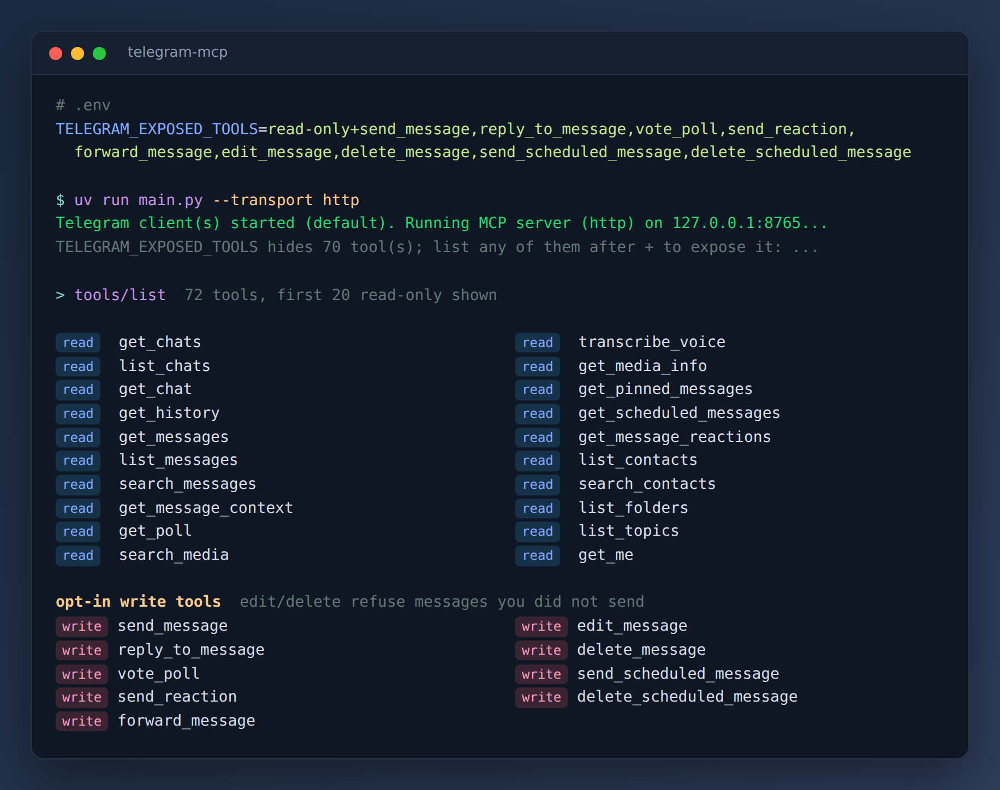
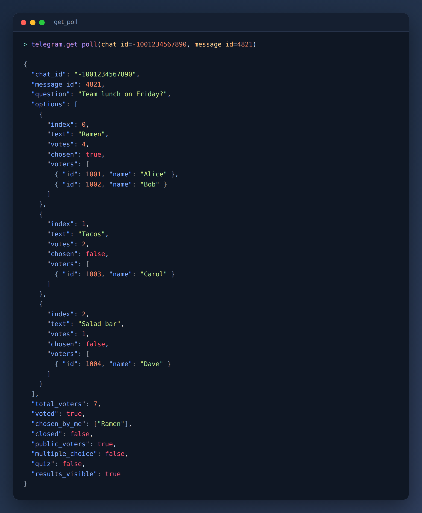
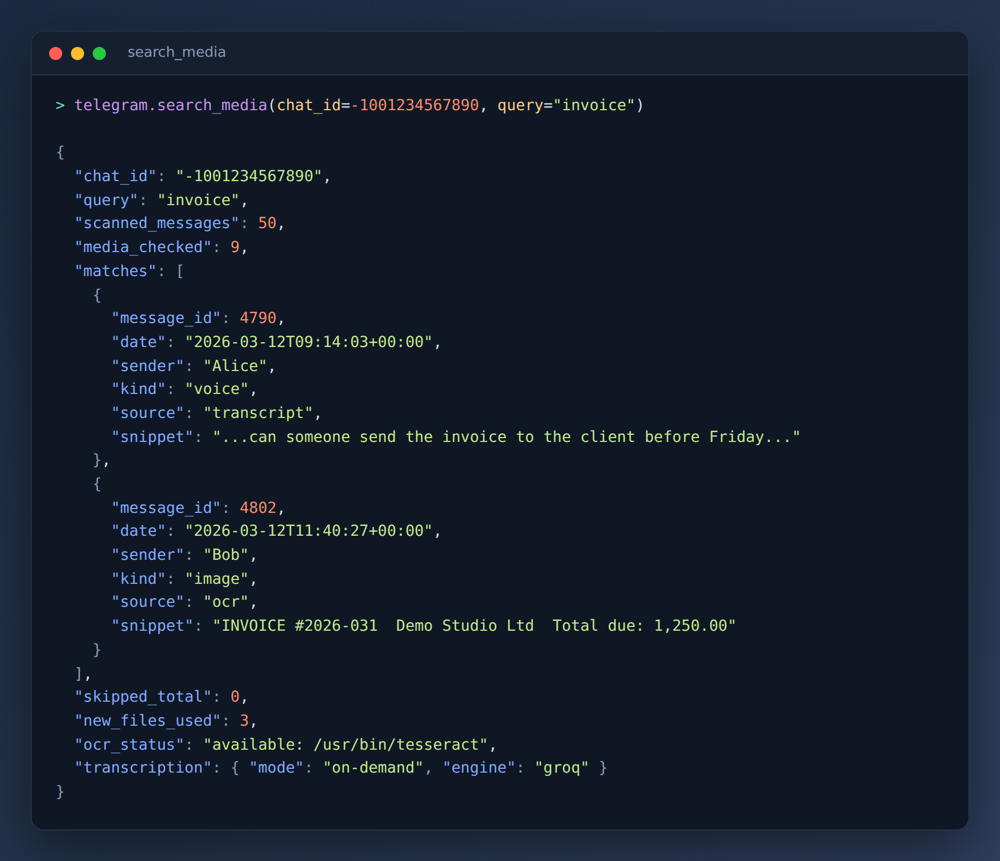

# telegram-mcp

An MCP server that lets Claude, Codex and other MCP clients read and act on your Telegram account, read-only unless you opt in.

This is a fork of [chigwell/telegram-mcp](https://github.com/chigwell/telegram-mcp) with poll, media search and transcription tools, plus tighter access controls.



## Features

- Read chats, history, contacts, folders, topics, pinned and scheduled messages.
- Polls. `get_poll` returns options, counts and your vote. `vote_poll` votes or retracts and returns the refreshed poll.
- Voice and video-note transcription through Groq Whisper, a local faster-whisper model, or any OpenAI-compatible endpoint. Transcripts are cached in SQLite.
- `search_media` finds text inside voice notes (transcribed) and images (OCR with Tesseract).
- Reactions, scheduled messages, forwarding.
- `edit_message` and `delete_message` only touch messages this account sent.
- Exposure presets. `read-only` is the default. `read-only+send_message,vote_poll` adds just the write tools you name.





## Quickstart

```bash
git clone https://github.com/kharitonov-egor/telegram-mcp.git
cd telegram-mcp
uv sync
uv run session_string_generator.py   # log in once, prints a session string
cp .env.example .env                 # then fill in the values below
uv run main.py                       # stdio; or MCP_TRANSPORT=http for a shared server
```

| Variable | Required | What it does |
| --- | --- | --- |
| `TELEGRAM_API_ID`, `TELEGRAM_API_HASH` | yes | From https://my.telegram.org/apps |
| `TELEGRAM_SESSION_STRING` | yes | Output of `session_string_generator.py` |
| `TELEGRAM_EXPOSED_TOOLS` | no | `read-only` (default), `all`, or `read-only+tool,tool` |
| `TELEGRAM_ALLOWED_CHAT_IDS` | no | Comma-separated chat IDs or @usernames. Everything else is refused |
| `GROQ_API_KEY` | no | Turns on voice transcription with Groq |
| `MCP_TRANSPORT` | no | `stdio` (default), `http` or `sse` |
| `MCP_HOST`, `MCP_PORT` | no | HTTP bind address, default `127.0.0.1:8765` |
| `MCP_AUTH_TOKEN` | no | Require `Authorization: Bearer <token>` on HTTP and SSE |

Point an HTTP client at `http://127.0.0.1:8765/mcp`, for example `claude mcp add --transport http telegram http://127.0.0.1:8765/mcp`.

Every other option (multiple accounts, proxies, Docker, file roots, the event feed) is in [docs/reference.md](docs/reference.md).

## Security

A session string is full access to the Telegram account. Keep `.env` and `*.session` files out of git; `.gitignore` already covers them.

- Tool exposure defaults to `read-only`. Write tools stay unregistered until you list them in `TELEGRAM_EXPOSED_TOOLS`.
- With `TELEGRAM_ALLOWED_CHAT_IDS` set, every tool that takes a chat refuses chats outside the list, and listing tools hide them. Unset means no restriction.
- `edit_message` and `delete_message` refuse messages sent by anyone else.
- HTTP and SSE bind to `127.0.0.1` by default. The server prints a warning if you bind elsewhere without `MCP_AUTH_TOKEN`.
- With `MCP_AUTH_TOKEN` set, requests need the bearer token, compared in constant time. After `MCP_AUTH_MAX_FAILURES` bad attempts (default 10) within `MCP_AUTH_LOCKOUT_SECONDS` (default 60) a client address gets HTTP 429 for that long.

None of this limits what the session itself can do. Anyone who reads your `.env` can skip the server entirely.

## Credits

Built on [chigwell/telegram-mcp](https://github.com/chigwell/telegram-mcp) and its contributors, and on [Telethon](https://github.com/LonamiWebs/Telethon). Apache-2.0, see [LICENSE](LICENSE).
